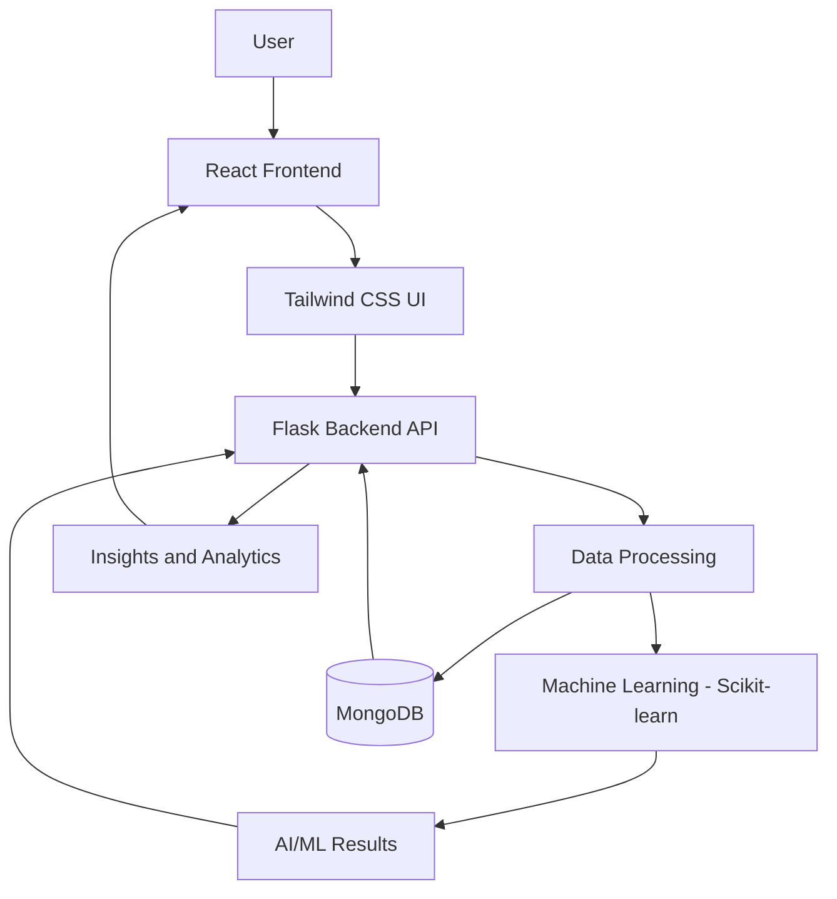

# 🏙️ Synora – AI Smart City

**Building Smarter Cities Through Artificial Intelligence and Data-Driven Solutions.**

Synora – AI Smart City is an intelligent urban management application designed to explore how Artificial Intelligence, Machine Learning, and web technologies can contribute to smarter and more efficient city management.

The platform combines a modern web interface with a Python-based backend and machine learning capabilities to process and analyze data, generate useful insights, and support data-driven urban decision-making.

By integrating AI/ML with full-stack development, Synora aims to demonstrate how technology can help address urban challenges and contribute to the development of smarter, more sustainable cities.

---

## 🌟 Key Features

| Feature | Description |
|---|---|
| 🏙️ Smart City Dashboard | A centralized interface for accessing and monitoring available city-related information. |
| 🤖 AI/ML Integration | Integrates machine learning capabilities for data analysis and intelligent processing. |
| 📊 Data Visualization | Presents available information and analytical results through an interactive interface. |
| 🧠 Intelligent Insights | Uses data-driven processing to provide useful insights for urban management. |
| 🌐 Interactive Web Interface | Provides a responsive and user-friendly frontend experience. |
| ⚙️ Backend API Integration | Connects the frontend with backend services through Flask APIs. |
| 🗄️ Database Integration | Uses MongoDB for storing and managing application data. |
| 📱 Responsive Design | Provides an accessible interface across different screen sizes. |

---

## 🏗️ System Architecture

Synora follows a full-stack architecture integrating frontend technologies, backend APIs, database services, and machine learning components.



### How It Works

1. **User Interaction:** Users interact with the application through the React-based frontend.
2. **Frontend Processing:** The interface handles user inputs and communicates with backend APIs.
3. **Backend Processing:** Flask receives requests and manages application logic.
4. **Data Management:** MongoDB stores and retrieves application data.
5. **Machine Learning:** Scikit-learn provides machine learning functionality for supported data-processing and analytical tasks.
6. **Results Generation:** The backend processes the results and returns relevant information.
7. **Frontend Display:** The React interface presents the available information and insights.

---

## 🧰 Technology Stack

| Category | Technologies |
|---|---|
| Frontend | React.js, JavaScript |
| UI Styling | Tailwind CSS |
| Backend | Python, Flask |
| Machine Learning | Scikit-learn |
| Database | MongoDB |
| Data Processing | Python |
| Development Tools | VS Code, Git, GitHub |

---

## 🧠 AI and Machine Learning Implementation

Synora integrates machine learning into a web-based smart city application.

**1. Data Processing**
- Processes application data through the Python backend.
- Prepares data for analytical and machine learning operations.

**2. Machine Learning Integration**
- Uses Scikit-learn for machine learning functionality.
- Supports data-driven analysis based on the implemented models.

**3. Backend Integration**
- Connects machine learning components with Flask APIs.
- Makes analytical results available to the frontend.

**4. Interactive Insights**
- Presents available analytical results through the React interface.
- Helps users interact with processed information through a centralized application.

---

## 🚀 Running the Project Locally

### Prerequisites

Install the following:

- Python 3.x
- Node.js and npm
- MongoDB
- Git

### 1. Clone the Repository

```bash
git clone https://github.com/YOUR_USERNAME/Synora-AI-Smart-City.git
cd Synora-AI-Smart-City
```

### 2. Set Up the Backend

Create a Python virtual environment:

```bash
python -m venv venv
```

Activate it on Windows:

```powershell
venv\Scripts\activate
```

Install backend dependencies:

```bash
pip install -r requirements.txt
```

### 3. Configure MongoDB

Ensure MongoDB is running.

Configure the database connection string using the environment variables expected by your backend.

Example `.env` configuration:

```env
MONGO_URI=your_mongodb_connection_string
```

Do not commit actual database credentials or secrets to GitHub.

### 4. Start the Flask Backend

Run the backend using the entry-point file in your project.

For example:

```bash
python app.py
```

Use the actual Flask entry-point filename and port configured in your project.

### 5. Start the React Frontend

Open another terminal:

```bash
cd frontend
npm install
npm run dev
```

Open the local URL displayed by Vite in your browser.

---

## 📁 Project Structure

```text
Synora-AI-Smart-City/
│
├── frontend/
│   ├── src/
│   │   ├── components/       # Reusable UI components
│   │   ├── pages/            # Application pages
│   │   ├── assets/           # Frontend assets
│   │   └── ...
│   ├── package.json
│   └── ...
│
├── backend/
│   ├── app.py                # Flask backend (if located here)
│   ├── models/               # Machine learning components
│   ├── ...
│
├── requirements.txt          # Python dependencies
├── .gitignore
└── README.md
```

*The structure is illustrative. Adjust the paths to match the actual repository.*

---

## 🧪 Testing

Backend testing:

```bash
python -m pytest -v
```

Frontend development checks:

```bash
cd frontend
npm run lint
```

Production build:

```bash
npm run build
```

---

## 🔒 Data Management and Security

Synora uses a backend-driven architecture with MongoDB for application data management.

Important considerations:

- Store database credentials securely using environment variables.
- Validate user inputs before processing.
- Avoid exposing sensitive information through API responses.
- Apply appropriate access controls to database operations.
- Keep machine learning inputs and outputs validated.

---

## 🔮 Future Enhancements

- Advanced AI-powered urban analytics.
- Improved machine learning models.
- More comprehensive smart city data visualization.
- Real-time data integration where supported.
- Predictive analytics for urban planning.
- Enhanced monitoring and decision-support capabilities.
- Integration with additional smart city services.

---

## 👩‍💻 About the Project

Synora – AI Smart City is a full-stack AI/ML project developed to explore the practical application of Artificial Intelligence, Machine Learning, Python backend development, and modern frontend technologies in urban management.

The project focuses on combining intelligent data processing with an interactive web application to demonstrate how technology can contribute to smarter and more efficient cities.

**Built with React, Tailwind CSS, Python, Flask, MongoDB, and Scikit-learn.**

---

⭐ If you find this project interesting, consider giving the repository a star!
